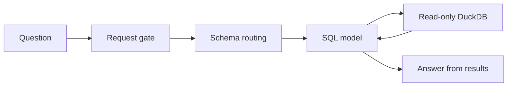

# GridRag

A small text-to-SQL demo over fictional US electricity data. It shows how a
model can select relevant schema, write SQL, and answer from query results.
The schema carries product knowledge; the pipeline stays the same as products
are added.



The gate classifies relevance and abuse. Routing selects whole tables and adds
their referenced tables automatically. The SQL model receives that schema slice,
can inspect data, and can repair a failed query using the returned error.
DuckDB access is independently restricted to read-only queries on selected tables.

## Run from scratch

From the repository root, with Python 3.11–3.13 and `uv` installed:

```sh
uv sync --locked
uv run python -m gridrag.warehouse.build
uv run python -m app
```

Open http://127.0.0.1:8000. The build command creates
`data/warehouse.duckdb` entirely from the checked-in schema and Python generators
in `gridrag/warehouse/`. No database download, external data source, or API key is
needed to build the warehouse or inspect preset references. The seed and date
range are fixed so reviewers get the same demonstration data.

To rebuild, stop the app and rerun the same build command; it replaces the
existing demo database. Generated `data/` files stay out of Git; all creation
code and `uv.lock` belong in the repository.

Set `OPENAI_API_KEY` in your environment or `.env`, then ask:

```sh
uv run python -m gridrag "What was ERCOT's highest hourly demand on October 19, 2026?"
uv run python -m gridrag "What share of PJM's generation came from natural gas in September 2026?"
uv run python -m gridrag "For CAISO_HUB on October 21, 2026 from 5 pm to 6 pm local, what was average real-time hub LMP minus day-ahead hourly hub LMP?"
```

These demonstrate a single measure, a calculation across tables, and a comparison
across time grains. The output shows the answer, how much schema was selected,
the SQL, and elapsed time and estimated model cost. Add `--verbose` for individual
routing scores and call diagnostics. Model calls send schema, the question, and
query results to the configured API.

## Local UI

```sh
uv run python -m app
```

Open http://127.0.0.1:8000. Choose one of six preset questions, inspect its
reference SQL and value, then click **Ask the grid**. You can also edit the
question. The UI highlights the active stage as the backend runs and shows selected schema, SQL,
returned data, timings and estimated cost. Use `--port 8001` for another port.

References run locally against the current warehouse and are never supplied to
the model. A **Numeric evidence matches** result means the last scalar query
result matches the reference within the displayed tolerance; it does not certify
the prose or SQL semantics. Other result shapes are marked **Needs review**.
Preset run statuses last for the current page session. Selecting a preset does
not call the API; clicking Ask does. One question runs at a time.

## Read the implementation

- `gridrag/answer.py`: orchestration of the three stages.
- `gridrag/gate.py` and `gridrag/route.py`: model decisions.
- `gridrag/sql/agent.py`: bounded SQL execution and repair loop.
- `gridrag/db.py`: database restrictions and result formatting.
- `gridrag/warehouse/`: synthetic data and documented schema.

New tables must be registered in the schema catalog with meaningful descriptions,
units, grain and references. There are no separate product-specific routing rules.
See [ROUTING.md](ROUTING.md) for the routing tradeoffs and validation status.

This demo demonstrates schema selection, not a measured claim of lower total cost
or unchanged accuracy. The router itself sees the catalog. Live checks must verify
answer quality and latency; offline tests alone cannot establish either.
