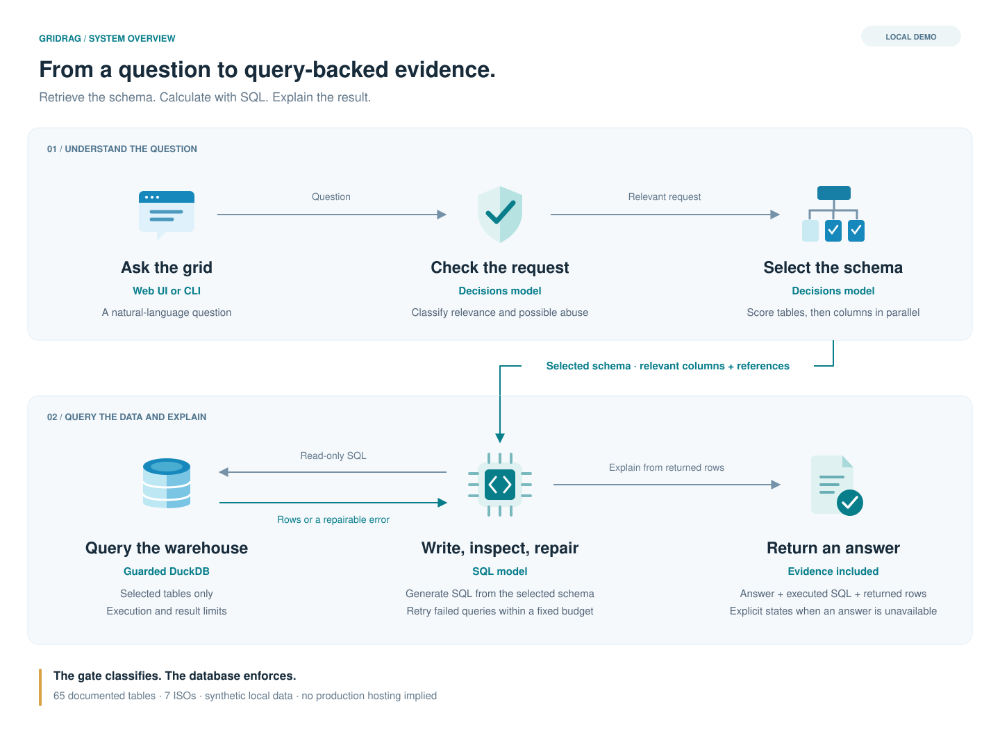

<p align="center">
  
</p>
<h1 align="center">GridRag</h1>
<p align="center"><strong>Ask the grid.</strong><br>
A small SQL-RAG system build for time series data over fictional US electricity gird data.</p>
<p align="center">
  <a href="#run-locally">Run locally</a> ·
  <a href="#architecture">Architecture</a> ·
  <a href="gridrag/warehouse/SCHEMA.md">Schema</a> ·
  <a href="#evaluation">Evaluation</a> ·
  <a href="#production-boundary">Production boundary</a>
</p>

## What it does

GridRag is a Retrieval-Augmented Generation (RAG) system tailored specifically for time-series energy data.

Standard RAG retrieves textual chunks—an approach that falls short for hourly and five-minute grid measurements, where accurate answers depend on relational joins and aggregations. Instead of retrieving text documents, GridRag retrieves database schemas and generates evidence using SQL.

Rather than relying on hand-crafted routing rules, GridRag uses a single decision-model call to score the documented schema across three dimensions: core tables, ISO-agnostic product families, and targeted ISO regions. The pipeline keeps top-scoring tables, expands selected product families to the target ISOs, and includes any dependent reference tables. The downstream SQL-generation model then operates strictly within this focused context.

Users can query grid demand, generation, pricing, forecasts, energy storage, or interconnection queues. GridRag isolates the necessary schema, executes read-only SQL queries, and synthesizes answers directly from the returned dataset. The UI provides real-time execution visibility—displaying selected schemas, generated SQL, raw evidence, latency metrics, and estimated API costs at each step.

## Architecture

[](docs/architecture.svg)

[View full size](docs/architecture.svg) · [Edit in draw.io](docs/architecture.drawio)

This is **structured-data RAG**: schema retrieval supplies context, SQL retrieves and aggregates evidence, and the model explains it. A vector database is not required.

| Layer | What it does |
| --- | --- |
| Gate → routing | Checks relevance and possible abuse; it does not grant data access. |
| Routing → SQL | Keeps whole selected tables, the requested ISOs' tables of each selected product family, and their references, preserving joins and calculation inputs. Mostly unusable scores fail the request instead of asking the user to narrow it. |
| SQL → database | Independently enforces read-only access, the routed catalog tables (matched case-insensitively), and execution/result budgets; it runs the query as DuckDB's parser regenerates it, so comments cannot change what runs. |
| Results → answer | Preserves query evidence and failures for inspection; SQL errors can be repaired within a fixed budget. |

## Run locally

Requires Python **3.11–3.13** and **uv**. From the repository root:

```sh
uv sync --locked
uv run python -m gridrag.warehouse.build
uv run python -m app
```

Open **http://127.0.0.1:8000**. Add `OPENAI_API_KEY=your-key` to a local `.env`
to run model questions. Building the database requires no API key or external
data downloads. Model access must support the
configured Decisions and Responses calls.

The build command creates `data/warehouse.duckdb` from checked-in code. To
rebuild, stop the app and rerun that command; it replaces the demo database.
The fixed seed and dates make the data reproducible. Generated data and `.env`
are ignored by Git.

The CLI uses the same pipeline:

```sh
uv run python -m gridrag "What was ERCOT's highest hourly demand on October 19, 2026?"
```

Add `--verbose` for routing and ISO scores and per-call diagnostics. API calls transmit
the question, selected context, and query results to the configured provider.

## Warehouse and schema

**65 tables · 7 ISOs · entirely fictional data**

| Data | Coverage |
| --- | --- |
| Hourly balance and generation | All ISOs; Jan 1, 2025–Oct 21, 2026 |
| Five-minute load and generation | CAISO and ERCOT; Oct 15–21, 2026 |
| Prices, forecasts, ancillary, storage, outages, curtailment | Eight products per ISO; Oct 15–21, 2026 |
| Interconnection queue | Current snapshot as of Oct 21, 2026 |

[Base DDL](gridrag/warehouse/schema.sql), [product definitions](gridrag/warehouse/products.py),
and [generator](gridrag/warehouse/build.py) are all included. The
[schema reference](gridrag/warehouse/SCHEMA.md) explains keys, grains, units,
coverage, and time semantics. The catalog is explicitly registered; adding a
database table alone does not expose it to the model, and the SQL guard only
allows catalog tables. Each ISO has an explicit id, and each product defines its
columns and the generator that fills its tables.

## Evaluation

```sh
# Deterministic checks; no provider requests, even if an API key is present.
uv run python -m unittest discover -s tests

# Explicitly opt into paid, live-model evaluations.
GRIDRAG_LIVE_TESTS=1 uv run python -m unittest discover -s tests -p 'test_live.py'
```

Offline tests cover SQL restrictions and normalization, timeout recovery,
precision, family routing and routing uncertainty, tool budgets, failures,
settings, and warehouse invariants.

Evaluation questions live in one table,
[gridrag/warehouse/evals.py](gridrag/warehouse/evals.py): each case pairs a
question with independent reference SQL, its expected end state, and tables the
route must or must not include. The UI offers the labelled cases as preset
questions. Live evaluations ask every case (fuel shares, interval values, queue
counts, bus and hub prices, price spreads, forecast cutoffs, battery energy, a
too-broad request, and declined requests) and require the answer to state the
reference value at the precision it shows. Live accuracy remains unverified in
this review. Broader paraphrase, unseen-schema,
and adversarial evaluations are required before deployment.

## Code and configuration

`answer.py` orchestrates; `gate.py` and `route.py` classify; `sql/agent.py`
prompts for SQL and handles repair; `db.py` enforces database restrictions;
`llm.py` owns provider calls and usage accounting. `records.py` defines the
records each stage returns or streams, as TypedDicts, and the `State` and `Stage`
names. `catalog.py` describes queryable tables (name, DDL, references) and the
per-ISO product families routing scores once; `demo_catalog()` adapts the demo
schema, and `answer(..., catalog=...)` accepts any other `Catalog`. `app/` and
`gridrag/warehouse/` are demo infrastructure.

[config.py](gridrag/config.py) defines one frozen `Settings` object with
thresholds, budgets, models, and illustrative cost rates, loaded once from `.env`
and the environment. Set `GRIDRAG_DECISIONS_MODEL` or `GRIDRAG_ANSWER_MODEL` in
either place to override model defaults. Modules read `config.settings` when they
need a value, so tests replace it in one place. Prompts stay beside their owning
stages; protocol strings stay literal. Cost estimates are not billing figures.

## Production boundary

The core has explicit safeguards, but this repository is a demo, not a
production service. The web app and warehouse generators are setup code.
Authentication, data entitlements, process-level resource isolation,
retention/logging policy, and measured model quality remain release requirements.
SQL interruption and memory settings are safeguards, not a complete sandbox.
The gate is a classifier, not an authorization layer.

The final core audit covered configuration, routing, provider calls, SQL execution,
failure handling, and module boundaries. Offline checks passed; live-provider
accuracy has not been verified in this review.
