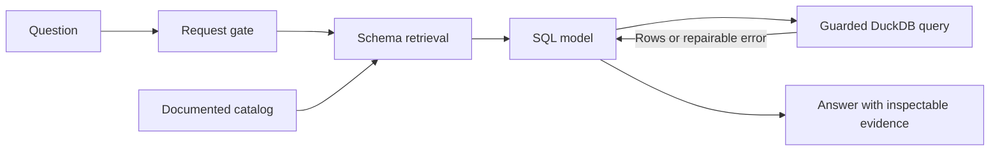

<p align="center">
  
</p>
<h1 align="center">GridRag</h1>
<p align="center"><strong>Ask the grid. Inspect the evidence.</strong><br>
A small, explainable SQL-RAG demo over fictional US electricity data.</p>
<p align="center">
  <a href="#run-locally">Run locally</a> ·
  <a href="#architecture">Architecture</a> ·
  <a href="gridrag/warehouse/SCHEMA.md">Schema</a> ·
  <a href="#evaluation">Evaluation</a> ·
  <a href="AUDIT.md">Engineering review</a>
</p>

## What it does

Ask about demand, generation, prices, forecasts, storage, or interconnection
projects. GridRag selects relevant schema, executes read-only SQL, and answers
from the returned rows. The UI shows the active stage, selected tables, SQL,
evidence, latency, and estimated model cost. Six presets have independent
reference queries for comparison.

## Architecture



This is **structured-data RAG**: schema retrieval supplies context, SQL retrieves
and aggregates evidence, and the model explains it. A vector database is not
required for this relational workload.

| Boundary | Why it matters |
| --- | --- |
| Gate → routing | Classifies scope; it does not grant database access. |
| Routing → SQL | Keeps whole selected tables and their references, preserving joins and calculation inputs. |
| SQL → database | Independently enforces read-only access, table restrictions, and execution/result budgets. |
| Results → answer | Preserves query evidence and failures for inspection; SQL errors can be repaired within a fixed budget. |

Product semantics live in schema documentation rather than product-specific
routing branches. New approved catalogs can be supplied through
`answer(question, catalog=...)`. Routing quality still needs evaluation; a
successful query alone does not establish answer correctness.

## Run locally

Requires Python **3.11–3.13** and **uv**. From the repository root:

```sh
uv sync --locked
uv run python -m gridrag.warehouse.build
uv run python -m app
```

Open **http://127.0.0.1:8000**. Add `OPENAI_API_KEY=your-key` to a local `.env`
to run model questions. Building the database and inspecting preset references
requires no API key or external data downloads. Model access must support the
configured Decisions and Responses calls.

The build command creates `data/warehouse.duckdb` from checked-in code. To
rebuild, stop the app and rerun that command; it replaces the demo database.
The fixed seed and dates make the data reproducible. Generated data and `.env`
are ignored by Git.

The CLI uses the same pipeline:

```sh
uv run python -m gridrag "What was ERCOT's highest hourly demand on October 19, 2026?"
```

Add `--verbose` for routing scores and per-call diagnostics. API calls transmit
the question, selected context, and query results to the configured provider.

## Warehouse and schema

**65 tables · 7 ISOs · entirely fictional data**

| Data | Coverage |
| --- | --- |
| Hourly balance and generation | All ISOs; Jan 1, 2025–Oct 21, 2026 |
| Five-minute load and generation | CAISO and ERCOT; Oct 15–21, 2026 |
| Prices, forecasts, ancillary, storage, outages, curtailment | Eight products per ISO; Oct 15–21, 2026 |
| Interconnection queue | Current snapshot as of Oct 21, 2026 |

[Base DDL](gridrag/warehouse/schema.sql), [product definitions](gridrag/warehouse/products.py),
and [generator](gridrag/warehouse/build.py) are all included. The
[schema reference](gridrag/warehouse/SCHEMA.md) explains keys, grains, units,
coverage, and time semantics. The catalog is explicitly registered; adding a
database table alone does not expose it to the model.

## Evaluation

```sh
# Deterministic checks; no provider requests, even if an API key is present.
uv run python -m unittest discover -s tests

# Explicitly opt into paid, live-model evaluations.
GRIDRAG_LIVE_TESTS=1 uv run python -m unittest discover -s tests -p 'test_live.py'
```

Offline tests cover SQL restrictions, timeout recovery, precision, routing
uncertainty, tool budgets, failures, and warehouse invariants. Live evaluations
compare representative questions with reference SQL: fuel shares, interval
values, queue counts, price spreads, forecast cutoffs, and battery energy.

UI preset checks compare the last scalar query result with an independent
reference; they do **not** grade prose or prove semantic correctness. Live
accuracy remains unverified in this review. Broader paraphrase, unseen-schema,
and adversarial evaluations are required before deployment.

## Code and configuration

`answer.py` orchestrates; `gate.py` and `route.py` classify; `sql/agent.py`
handles SQL repair; `db.py` enforces database restrictions; `llm.py` owns provider
calls and usage accounting. `catalog.py` adapts the demo schema. `app/` and
`gridrag/warehouse/` are demo infrastructure.

[config.py](gridrag/config.py) names thresholds, budgets, models, and illustrative
cost rates. Export `GRIDRAG_DECISIONS_MODEL` or `GRIDRAG_ANSWER_MODEL` to override
model defaults. Prompts stay beside their owning stages; protocol strings stay
literal. Cost estimates are not billing figures.

**Production boundary:** the core has explicit safeguards, but this repository
is not a production service. Authentication, data entitlements, process-level
resource isolation, retention/logging policy, and measured model quality remain
release requirements. See the [engineering audit](AUDIT.md) for findings and
explicit demo exceptions.
