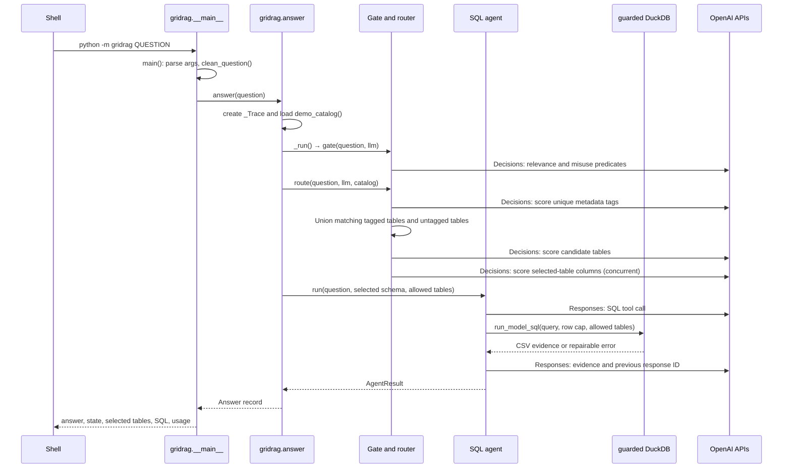

# Trace one CLI request to function boundaries

Example:

```sh
uv run python -m gridrag "What was ERCOT's highest hourly demand on October 19, 2026?"
```

This follows the command-line path only. It starts in Python's module entry
point and ends when the CLI prints the answer and its evidence. No browser or
HTTP handler is involved.

## Call path



## Function boundaries, in order

1. **Python enters the CLI.** [`gridrag/__main__.py`](gridrag/__main__.py) has
   the `if __name__ == "__main__"` block, which calls `main()`. `main()` uses
   `argparse` to read the question and optional `--verbose` flag. It calls
   `answer.clean_question()` before starting the pipeline. Invalid or oversized
   input is reported by `parser.error()` and exits here.

2. **CLI calls the orchestrator.** `main()` calls `answer.answer(question)`.
   It does not pass an LLM, so [`gridrag/answer.py`](gridrag/answer.py)'s
   `answer()` creates `LLM()` and calls `demo_catalog()` to load the cached
   warehouse metadata. The question is cleaned again at this public API
   boundary. `_Trace` begins recording stage times, progress, tool calls, and
   usage. The CLI path uses the locally configured `OPENAI_API_KEY` through
   `gridrag.llm.client()`, which creates a process-local provider client on
   first use.

3. **Orchestrator runs the gate.** `answer()` calls `_run()`. Its first timed
   stage is `gridrag.gate.gate(question, llm)`. The gate makes one Decisions
   request with two predicates: is this a structured-data question, and is it
   an instruction-hijacking or unsafe database request? The returned values are
   validated as probabilities. A declined request returns before schema routing
   or SQL generation.

4. **Router selects a schema slice.** For an allowed request, `_run()` calls
   `gridrag.route.route(question, llm, catalog)`:
   - The metadata filter sends only the catalog's unique tag names to a compact
     Decisions request. Relevant tags select the union of matching tables, with
     untagged tables retained. For this request, `load` makes actual-demand
     tables available. With no matching tags, use the full catalog; a completely
     untagged catalog skips the extra model call.
   - `_score_tables()` sends one predicate for each candidate table in one
     Decisions request. `core.fact_balance_hourly` is the essential source for
     hourly `demand_mw`; `core.dim_iso` identifies ERCOT by `iso_code`. The
     actual selected route is determined by model scores and configured
     thresholds, so extra selected tables are possible.
   - `_with_references()` adds declared foreign-key targets transitively.
   - `_score_selected_columns()` makes a Decisions call for each retained table
     using a bounded thread pool. `_select_columns()` keeps columns above the
     threshold plus structural keys and time columns.
   - If the route exceeds its table budget, `RoutingTooBroad` becomes a
     clarification. An empty route becomes an abstention before SQL.

5. **Router output becomes SQL context.** `_run()` calls
   `Table.selected_schema()` for the selected tables and their retained
   columns. `render_grounding()` adds approved vocabulary for included columns.
   This is schema metadata; it does not include warehouse result rows.

6. **SQL agent requests query evidence.** `_run()` calls
   [`gridrag/sql/agent.py`](gridrag/sql/agent.py), `agent.run()`, with the
   question, reduced schema, grounding, and routed table allowlist. `agent.run()`
   sends these instructions and the `run_sql` function tool to the Responses API
   using `LLM.respond()`.

   A suitable SQL shape is:

   ```sql
   SELECT MAX(b.demand_mw) AS peak_demand_mw
   FROM core.fact_balance_hourly AS b
   JOIN core.dim_iso AS i USING (iso_id)
   WHERE i.iso_code = 'ERCOT'
     AND b.interval_start_local >= TIMESTAMP '2026-10-19 00:00:00'
     AND b.interval_start_local <  TIMESTAMP '2026-10-20 00:00:00';
   ```

   This is an illustrative query, not a prediction of the SQL generated on a
   particular run. `MAX` finds the peak power in MW; summing MW readings would
   answer a different question. The schema defines `interval_start_local` as
   the ISO's clock for calendar-date filters. The independent evaluation case
   records a matching reference query in [`gridrag/evals/cases.py`](gridrag/evals/cases.py);
   that reference is not passed to the live CLI pipeline.

7. **Tool call is validated and executed.** `_next_tool_call()` checks the
   Responses result and tool-call budget. `_execute_sql()` parses the tool's
   JSON arguments, then calls
   [`gridrag/sql/db.py`](gridrag/sql/db.py), `run_model_sql(query, max_rows,
   allowed_tables)`. The database boundary checks query length and row count,
   opens a read-only DuckDB cursor with external access disabled and a timeout,
   and calls `_check()` to ensure there is exactly one SELECT over routed tables
   with allowed table functions. DuckDB normalizes the checked query before
   execution. `_fetch()` applies a `max_rows + 1` wrapper; `_result()` returns
   CSV evidence or a bounded error.

   Query errors are returned to the model as data so it can repair the SQL.
   They do not grant access to tables outside the route.

8. **Agent sends evidence back to the model.** `_execute_sql()` turns the
   returned CSV or error into a `function_call_output` with the provider's call
   ID. `agent.run()` sends it in a subsequent Responses request with
   `previous_response_id`. The model can answer from the evidence or request
   another sequential query while the configured round budget permits.

9. **Orchestrator builds the final record.** `_finish_answer()` sets the agent
   state: `answered` requires at least one successful query with CSV;
   `abstained` means no query ran; `write_failed` means queries ran but none
   succeeded. Back in `answer()`, `_Trace.record()` combines that answer with
   the question, gate result, selected schema, SQL/CSV evidence, timings, and
   usage totals. Exceptions inside the pipeline become a `failed` record with
   a user-safe message and diagnostic type.

10. **CLI prints and exits.** `main()` passes the record to `_print_result()`.
    It prints the answer, state, gate reason, selected tables, each SQL call and
    its row/error summary, total time, model-call count, and estimated cost.
    With `--verbose`, `_print_diagnostics()` also prints table and column scores,
    per-stage timing, token usage, and per-call details. The CLI exits nonzero
    for `failed` and `write_failed` states.

## Fixed facts versus run-time results

- **Schema facts:** `core.fact_balance_hourly.demand_mw` is actual hourly
  demand in MW; `interval_start_local` is the region's local clock;
  `core.dim_iso.iso_code` identifies ERCOT. The warehouse is synthetic and
  fixed, not live ERCOT telemetry. See
  [`gridrag/warehouse/SCHEMA.md`](gridrag/warehouse/SCHEMA.md).
- **Evaluation-only fact:** an independent expected query is in
  [`gridrag/evals/cases.py`](gridrag/evals/cases.py). It is not an input to
  routing or SQL generation.
- **Run-time results:** gate scores, selected tables and columns, exact SQL,
  repair turns, numeric peak, timings, and token totals depend on model
  responses and the built warehouse. No live model request was made while
  writing this trace, so it does not claim a generated numeric answer.

## Typical provider-call count

If `T` tables remain after reference expansion and the SQL agent uses `R`
Responses turns, a successful request against the tagged demo catalog typically
makes `1` gate Decisions call, `1` metadata-tag Decisions call, `1` candidate-table
Decisions call, `T` column Decisions calls, and `R` Responses calls. An untagged
catalog omits the metadata-tag call and sends all tables to table scoring.
Column decisions run concurrently, but they are still separate provider calls.
SDK retries and failed paths can change actual provider traffic; usage records
count application-level calls.
